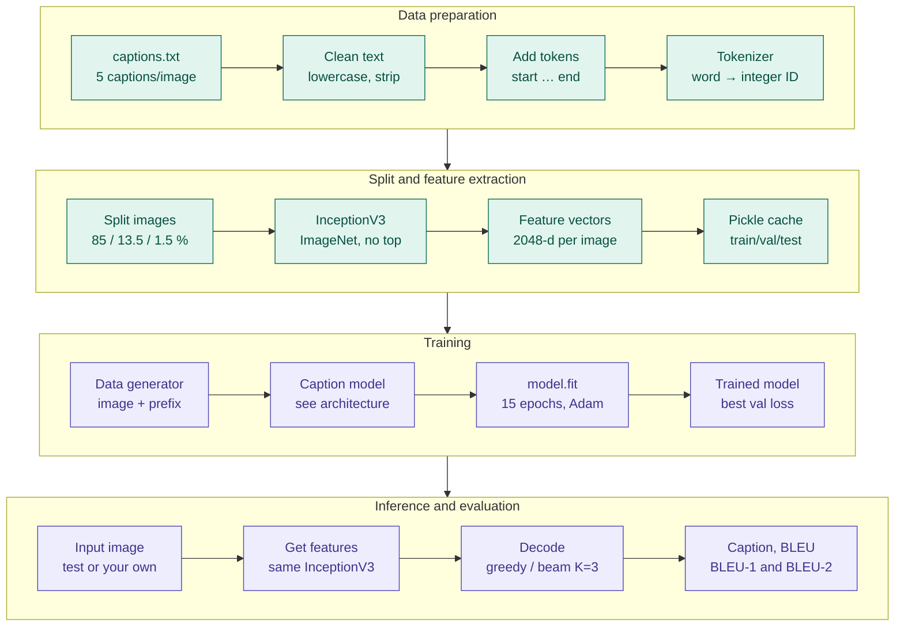
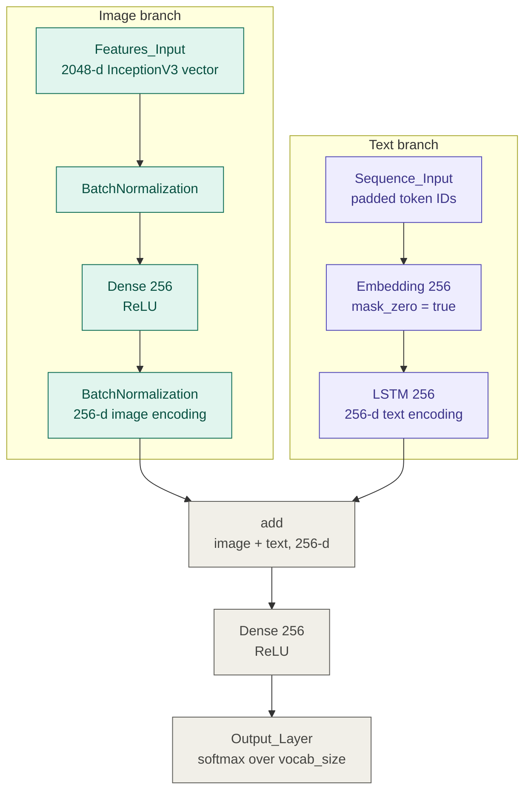

# Image Captioning with CNN + LSTM

An end-to-end image captioning system that looks at a photo and writes a one-sentence description of it. A pretrained **InceptionV3** CNN encodes the image into a 2048-dimensional feature vector, and an **LSTM** decoder generates the caption one word at a time. Captions can be decoded with **greedy search** or **beam search**, and are evaluated with **BLEU-1 / BLEU-2**.


---

## Table of contents

- [Highlights](#highlights)
- [Project overview](#project-overview)
- [Model architecture](#model-architecture)
- [Dataset](#dataset)
- [Project structure](#project-structure)
- [Installation](#installation)
- [Usage](#usage)
- [Training details](#training-details)
- [Results](#results)
- [Limitations and future work](#limitations-and-future-work)
- [Acknowledgements](#acknowledgements)
- [License](#license)

---

## Highlights

- **Transfer learning:** InceptionV3 (ImageNet weights) is used as a fixed feature extractor, so the captioning model only has to learn the language side.
- **Feature caching:** image features are extracted once and saved to disk, which makes training far faster than running the CNN every epoch.
- **Merge-style decoder:** image and text encodings are combined with an element-wise `add`, then passed through a dense layer and a softmax over the vocabulary.
- **Two decoding strategies:** greedy search (fast) and beam search with K = 3 (usually higher quality).
- **Memory-friendly training:** a Python generator builds batches on the fly instead of holding every (image, prefix, next-word) sample in memory.

---

## Project overview

The pipeline has four phases: data preparation, split and feature extraction, training, and inference with evaluation.



### How it works

1. **Caption cleaning.** Captions are lowercased, punctuation and digits are removed, and extra whitespace is collapsed. Each caption is wrapped as `start ... end` so the decoder learns where a sentence begins and when to stop.
2. **Tokenization.** A Keras `Tokenizer` is fit on all cleaned captions, assigning each unique word an integer ID.
3. **Splitting.** Images are split by image ID (not by caption) so that no image appears in more than one split. This avoids leaking test images into training.
4. **Feature extraction.** Each image is resized to 299 x 299, preprocessed for InceptionV3, and passed through the network with its classification layer removed. The result is a 2048-d vector per image, saved as a pickle file.
5. **Training samples.** A caption of length *n* is expanded into *n - 1* samples. The input is the image vector plus the first *i* words (padded to the maximum caption length), and the target is word *i + 1*, one-hot encoded over the vocabulary.
6. **Generation.** At inference time the model starts from `start`, predicts the next word, appends it to the prefix, and repeats until it produces `end` or reaches the maximum length.

---

## Model architecture

Two branches encode the image and the partial caption into 256-dimensional vectors. These are added together and decoded into a probability distribution over the next word.



| Property | Value |
| --- | --- |
| CNN encoder | InceptionV3 (ImageNet weights, classification layer removed) |
| Image feature size | 2048 |
| Embedding / LSTM / Dense units | 256 |
| Vocabulary size | 8,586 |
| Max caption length | 34 tokens |
| Total parameters | 5,529,482 (about 21 MB) |
| Trainable parameters | 5,524,874 |
| Loss | Categorical cross-entropy |

---

## Dataset

This project uses **Flickr8k**: 8,091 images, each with 5 human-written captions (40,455 captions in total).

Download it from Kaggle: [adityajn105/flickr8k](https://www.kaggle.com/datasets/adityajn105/flickr8k). After extracting, you need an `Images/` folder and a `captions.txt` file.

Place them like this:

```
data/
├── Images/
└── captions.txt
```

The dataset is not included in this repository.

| Split | Images | Share |
| --- | ---: | ---: |
| Train | 6,877 | 85% |
| Validation | 1,092 | 13.5% |
| Test | 122 | 1.5% |

---

## Project structure

```
image-captioning/
├── README.md
├── requirements.txt
├── .gitignore
├── notebooks/
│   └── main.ipynb          # full walkthrough with outputs and plots
├── src/
│   ├── config.py           # paths and hyperparameters
│   ├── data.py             # load, clean, tokenize, split, data generator
│   ├── features.py         # InceptionV3 feature extraction
│   ├── model.py            # build_model
│   ├── train.py            # training loop, callbacks, LR schedule
│   ├── inference.py        # greedy and beam-search captioning
│   └── evaluate.py         # BLEU scoring
├── data/                   # Flickr8k goes here (not committed)
├── artifacts/              # features, tokenizer, trained model (not committed)
└── assets/                 # sample outputs and diagrams for the README
```

The notebook contains the complete experiment with saved outputs. The `src/` package is the same logic split into reusable modules.

---

## Installation

```bash
git clone https://github.com/<your-username>/<repo-name>.git
cd <repo-name>

python -m venv .venv
# Windows
.venv\Scripts\activate
# macOS / Linux
source .venv/bin/activate

pip install -r requirements.txt
```

**Requirements:** `tensorflow` (2.16 or newer, for the `.keras` model format), `numpy`, `scikit-learn`, `nltk`, `matplotlib`, `seaborn`, `pillow`, `tqdm`.

A GPU is strongly recommended for training. The model in this repo was trained on Google Colab.

---

## Usage

Run the steps in order from the repository root.

**1. Extract image features** (one-time step, saves features and the tokenizer to `artifacts/`):

```bash
python -m src.features
```

**2. Train the model:**

```bash
python -m src.train
```

**3. Evaluate on the test split** (BLEU-1 and BLEU-2 for greedy and beam search):

```bash
python -m src.evaluate
```

**4. Caption your own image:**

```bash
python -m src.inference --image path/to/photo.jpg --method beam --beams 3
```

Use `--method greedy` for faster, simpler decoding.

You can also open `notebooks/main.ipynb` to run everything interactively.

---

## Training details

| Setting | Value |
| --- | --- |
| Optimizer | Adam, learning rate 0.01, gradient clipping (`clipnorm=1.0`) |
| LR schedule | Multiplied by `exp(-0.6)` after each epoch |
| Batch size | 270 (train), 150 (validation) |
| Max epochs | 15 |
| Early stopping | Monitors `val_loss`, patience 3, restores best weights |
| Steps per epoch | `len(train_captions) // 270` |
| Hardware | Google Colab |

---

## Results

Evaluation uses BLEU-1 and BLEU-2 against the five reference captions of each test image.

| Decoding | BLEU-1 | BLEU-2 |
| --- | ---: | ---: |
| Greedy search | TBD | TBD |
| Beam search (K = 3) | TBD | TBD |

### Sample outputs

Add a screenshot of your generated captions here:

```markdown

```

---

## Limitations and future work

- **Small dataset.** Flickr8k has only about 8,000 images, so the vocabulary and the scenes the model has seen are limited. Captions tend to be generic.
- **Global image features.** The decoder sees a single 2048-d vector per image and cannot look at specific regions while writing each word.
- **Frozen encoder.** InceptionV3 is not fine-tuned.
- **Limited metrics.** BLEU only measures n-gram overlap with the references and misses meaning. CIDEr, METEOR, and ROUGE-L would give a fuller picture.

Ideas for improvement:

- Add an **attention mechanism** over spatial CNN features (Show, Attend and Tell style).
- Replace the LSTM with a **Transformer decoder**.
- Train on a larger dataset such as Flickr30k or MS COCO.
- Fine-tune the top layers of the CNN.
- Use pretrained word embeddings such as GloVe.

---

## Acknowledgements

- Dataset: [Flickr8k](https://www.kaggle.com/datasets/adityajn105/flickr8k)
- CNN encoder: InceptionV3, via `tf.keras.applications`
- Inspired by *Show and Tell: A Neural Image Caption Generator* (Vinyals et al., 2015)

---

## License

This project is released under the MIT License. See [LICENSE](LICENSE) for details.